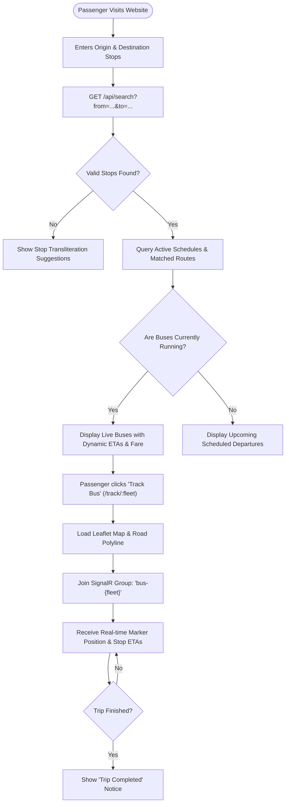
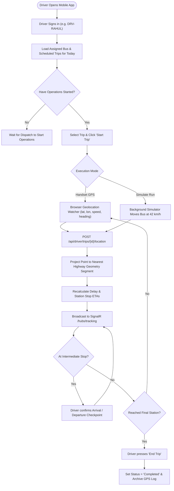
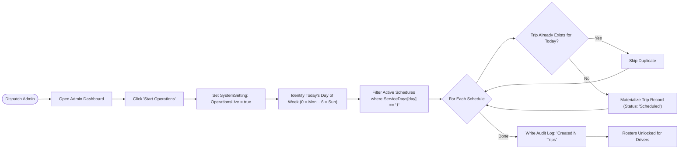
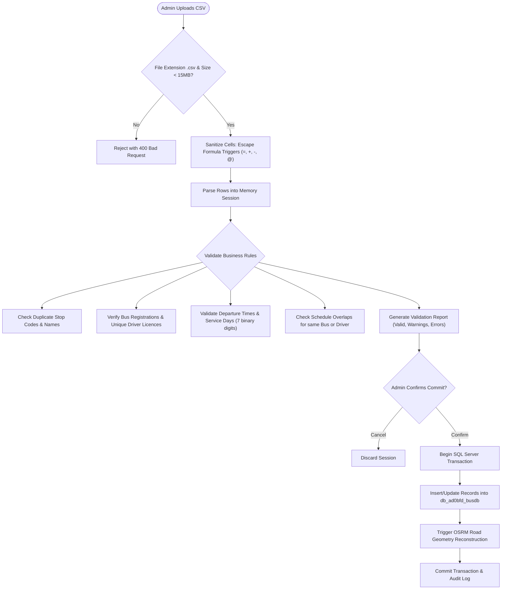
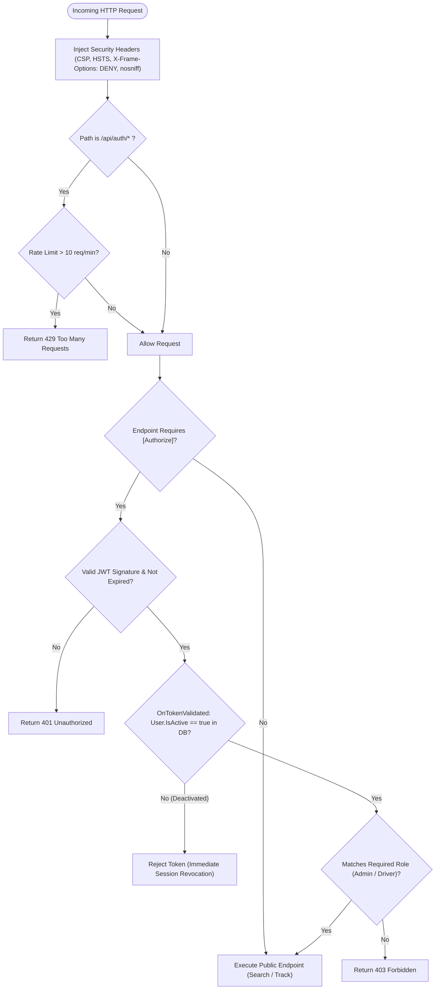
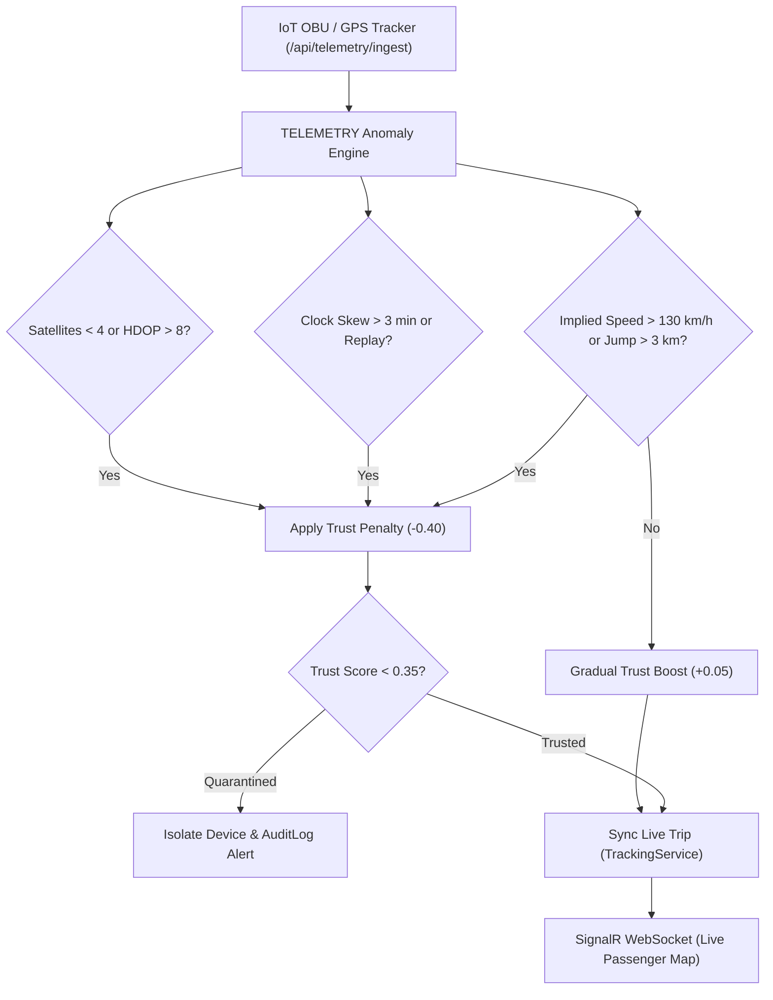

# System Architecture & Workflows

This document outlines the end-to-end architecture, runtime communication channels, data lifecycles, and security controls for the **Where Is My Bus (BusTrack Platform)**.

---

## Table of Contents

1. [High-Level Architecture & Communication Flow](#1-high-level-architecture--communication-flow)
2. [Passenger Search & Live Tracking Flow](#2-passenger-search--live-tracking-flow)
3. [Driver Trip Lifecycle & GPS Telemetry Flow](#3-driver-trip-lifecycle--gps-telemetry-flow)
4. [Dispatch Operations & Schedule Materialization Flow](#4-dispatch-operations--schedule-materialization-flow)
5. [Bulk Schedule CSV Upload & Validation Flow](#5-bulk-schedule-csv-upload--validation-flow)
6. [Authentication & Security Middleware Flow](#6-authentication--security-middleware-flow)
7. [EU Horizon TELEMETRY IoT Defense Framework](#7-eu-horizon-telemetry-iot-defense-framework)

---

## 1. High-Level Architecture & Communication Flow

The platform is split into a **React 18 SPA**, an **ASP.NET Core 8 Web API** with real-time **SignalR WebSockets**, **Microsoft SQL Server**, and the **Project OSRM** road geometry engine.

```mermaid
flowchart TD
    subgraph Clients["Frontend Clients"]
        P["Passenger Web (React + Leaflet)"]
        D["Driver Console (Mobile Web)"]
        A["Dispatch Admin Dashboard"]
    end

    subgraph Gateway["API Gateway & Security"]
        RL["Rate Limiter (10 req/min)"]
        SEC["Security Headers & CORS"]
        JWT["JWT Auth & Invalidation Hook"]
    end

    subgraph Backend["ASP.NET Core 8 Web API"]
        CTRL["REST Controllers (Search, Admin, Driver)"]
        HUB["SignalR Hub (/hubs/tracking)"]
        GEO["Geometry & Stop Normalizer Service"]
    end

    subgraph Storage["Data & External Services"]
        SQL[("SQL Server (db_ad0bfd_busdb)")]
        OSRM["Project OSRM Routing Engine"]
    end

    P -->|HTTPS REST| SEC
    D -->|GPS Telemetry POST| SEC
    A -->|Admin Operations| SEC

    SEC --> RL --> JWT --> CTRL
    P <-->|WebSockets (Live GPS)| HUB
    CTRL <--> HUB
    CTRL --> GEO
    GEO <--> OSRM
    CTRL <--> SQL
```

### Architecture Components
- **Passenger Web (`client/src/pages`)**: Public responsive web app. Allows search, route exploration, and real-time map tracking without requiring mandatory login.
- **Driver Console (`client/src/pages/Driver.tsx`)**: Dedicated mobile-optimized interface for assigned drivers to stream GPS telemetry or test corridors via simulator.
- **Dispatch Control Room (`client/src/pages/admin`)**: Operations management portal for schedules, buses, drivers, stops, fare slabs, and bulk imports.
- **SignalR Hub (`src/BusTrack.Api/Hubs/TrackingHub.cs`)**: Distributes real-time GPS coordinates to connected passengers subscribed to specific bus channels (`bus-{fleet}`) or the live board.
- **Routing Engine (`src/BusTrack.Api/Services/RoadRouter.cs`)**: Queries Project OSRM to generate polyline road coordinates following actual highways.

---

## 2. Passenger Search & Live Tracking Flow

Describes the passenger lifecycle from initial search between any two stops to live map updates over SignalR.



---

## 3. Driver Trip Lifecycle & GPS Telemetry Flow

Outlines how drivers authenticate, begin active scheduled runs, submit GPS coordinates, and mark station arrival/departure timestamps.



---

## 4. Dispatch Operations & Schedule Materialization Flow

Explains how recurring weekly schedules (`ServiceDays: 1111111`) are transformed into concrete daily trip instances when dispatch starts morning operations.



---

## 5. Bulk Schedule CSV Upload & Validation Flow

Details the safety, sanitization, dry-run validation, and execution pipeline for bulk uploading transit master data from CSV spreadsheets.



---

## 6. Authentication & Security Middleware Flow

Illustrates defensive security layers enforcing rate limits, HTTP security headers, CORS restrictions, token verification, and real-time session invalidation.



---

## 7. EU Horizon TELEMETRY IoT Defense Framework

The platform integrates the cybersecurity methodologies of the **EU Horizon TELEMETRY Project** ([telemetry-project.eu](https://telemetry-project.eu/)) for automated security testing and anomaly detection of IoT telematics devices (On-Board Units / GPS trackers).

### Multi-Layer Anomaly Detection:
1. **Kinematic & Velocity Verification**: Computes implied velocity between consecutive pings using the Haversine formula over elapsed time. Flags `SPOOFING_IMPOSSIBLE_SPEED` if velocity exceeds 130 km/h or `SPOOFING_TELEPORTATION_JUMP` if spatial displacement exceeds 3 km in under 10 seconds.
2. **Clock Skew & Replay Defense**: Rejects packets with timestamps > 3 minutes in the future (`FUTURE_TIMESTAMP_DRIFT`) or older than 24 hours (`EXPIRED_OR_REPLAY_TIMESTAMP`) to thwart GNSS spoofing and replay attacks.
3. **GNSS Signal Quality Checks**: Assesses receiver metrics; flags `LOW_SATELLITE_COUNT` (< 4 satellites) or `DEGRADED_HDOP_ACCURACY` (HDOP > 8.0).
4. **Dynamic Trust Score Model**: Maintains a rolling trust score `[0.0, 1.0]` per device. Clean packets restore trust (+0.05). Anomalies apply graded penalties (-0.10 to -0.40). Devices falling below the quarantine threshold (< 0.35) are isolated from passenger live maps.
5. **Real-time Incident Logging**: Automatically writes detected anomalies with payload coordinates and trust metrics into SQL Server `AuditLogs`.



